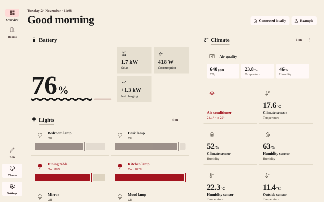
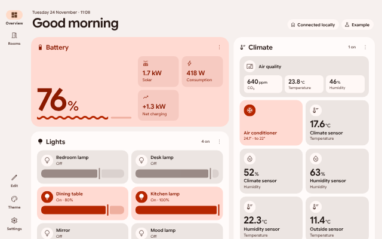
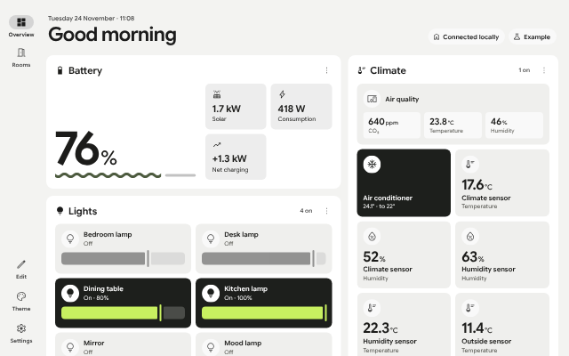
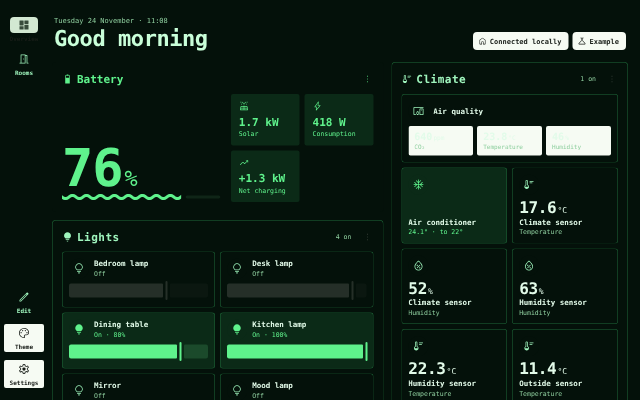

[Nederlands](README.nl.md)

# Expressive Home themes

Themes for [Expressive Home](https://github.com/DIMENTS/expressive-home), the dashboard for Homey Pro, made by people who use it. Every theme here was checked with the app’s own code before it was added.

**To use one:** open the theme, copy its share code, and in Expressive Home open Theme → Theme from someone else and paste it. Own CSS from someone else only works in full once you allow it on your device.

**To share yours:** [send it in with the form](https://github.com/DIMENTS/expressive-home-themes/issues/new?template=theme.yml). A check looks it over and makes the previews; the owner of the gallery decides.

## Themes

| | | |
|:-:|:-:|:-:|
|  **[Krant](themes/krant/)** by DIMENTS · own CSS · needs 1.3.0 |  **[Nacht](themes/nacht/)** by DIMENTS · needs 1.2.0 |  **[Strak](themes/strak/)** by DIMENTS · needs 1.2.0 |
|  **[Terminal](themes/terminal/)** by DIMENTS · own CSS · needs 1.3.0 |   |   |

The themes are shared under [CC BY 4.0](LICENSE): use and change them, and name the maker.
