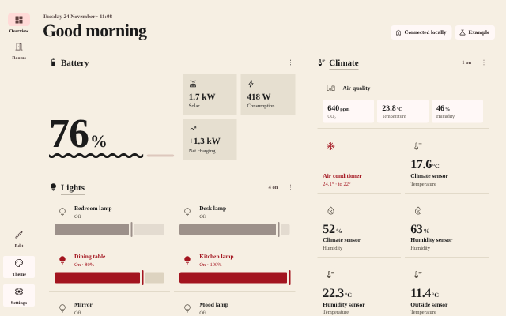
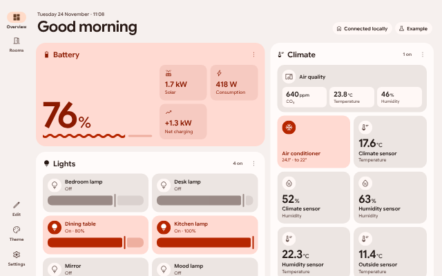
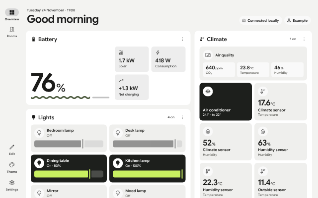
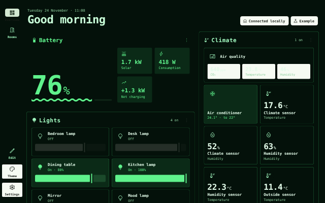

[English](README.md)

# Thema’s voor Expressive Home

Thema’s voor [Expressive Home](https://github.com/DIMENTS/expressive-home), het dashboard voor Homey Pro, gemaakt door wie het gebruikt. Elk thema hier is nagekeken met de code van het appje zelf voordat het werd toegevoegd.

**Gebruiken:** open het thema, kopieer de deelcode, en open in Expressive Home Thema → Thema van een ander en plak hem. Eigen CSS van een ander werkt pas helemaal als je het op je eigen apparaat toestaat.

**Zelf delen:** [stuur het in met het formulier](https://github.com/DIMENTS/expressive-home-themes/issues/new?template=theme.yml). Een controle kijkt het na en maakt de voorbeelden; de eigenaar van de galerij beslist.

## Thema’s

| | | |
|:-:|:-:|:-:|
|  **[Krant](themes/krant/)** door DIMENTS · eigen CSS · nodig 1.3.0 |  **[Nacht](themes/nacht/)** door DIMENTS · nodig 1.2.0 |  **[Strak](themes/strak/)** door DIMENTS · nodig 1.2.0 |
|  **[Terminal](themes/terminal/)** door DIMENTS · eigen CSS · nodig 1.3.0 |   |   |

De thema’s worden gedeeld onder [CC BY 4.0](LICENSE): gebruik en verander ze, en noem de maker.
