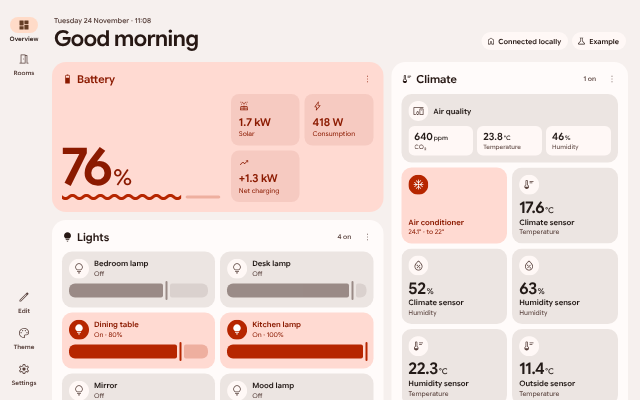
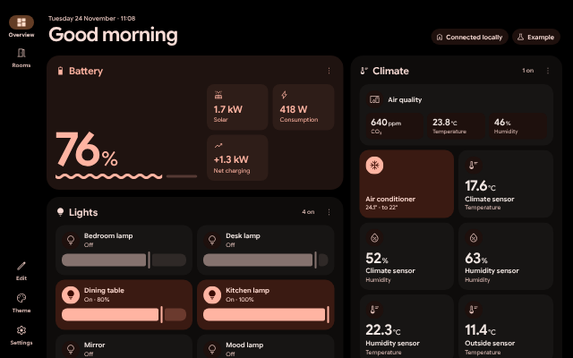

# Nacht

 

**Made by / Gemaakt door** [DIMENTS](https://github.com/DIMENTS) · **Needs / Nodig** Expressive Home 1.2.0 or newer / of nieuwer · **Added / Toegevoegd** 2026-11-25

> Dark with warm red and orange, for the evening. Donker met warm rood en oranje, voor de avond.

## Share code / Deelcode

Copy the code. In Expressive Home, open Theme → Theme from someone else, and paste it. / Kopieer de code. Open in Expressive Home Thema → Thema van een ander, en plak hem.

```text
EH2.eyJmb3JtYXQiOjIsImlkIjoidC1uYWNodDAwMDAwMDAwMDAxIiwibmFtZSI6Ik5hY2h0IiwibWFrZXIiOiJESU1FTlRTIiwiYmFzZSI6InJ1c3RpZyIsInNlZWQiOiIjYjU0NTJiIiwidXNlclNlZWQiOmZhbHNlLCJrbm9icyI6eyJzdHJlbmd0aCI6InZpdmlkIn0sImFwcCI6IjEuMy4wIiwidmFsdWVzIjp7ImRhcmsiOnsicGFnZS1iZyI6IiMwMDAwMDAiLCJzZWN0aW9uLWJnIjoiIzBlMGMwYiIsInRpbGUtYmciOiIjMTcxNTE0IiwidGlsZS1mZyI6IiNmMWU2ZTIiLCJ0aWxlLW9uLWJnIjoiIzNhMWExMiIsInRpbGUtb24tZmciOiIjZmZkYmQxIiwidGlsZS1pY29uLW9uLWJnIjoiI2ZmYjRhMiIsInRpbGUtaWNvbi1vbi1mZyI6IiMzYTBiMDIiLCJ0aWxlLW9uLXNsaWRlci1maWxsIjoiI2ZmYjRhMiIsInRpbGUtb24tc2xpZGVyLXRyYWNrIjoiIzZiM2EyZSIsInNlY3Rpb24taGVyby1iZyI6IiMxZjEzMTAiLCJzZWN0aW9uLWhlcm8tZmciOiIjZmZiNGEyIiwiaGVyby13YXZlLWZnIjoiI2ZmYjRhMiIsImhlcm8tY2hhcnQtbGluZSI6IiNmZmI0YTIiLCJoZXJvLXN0YXQtYmciOiIjMmUxZDE4In0sImxpZ2h0Ijp7InBhZ2UtYmciOiIjZjZmMGVlIiwic2VjdGlvbi1iZyI6IiNmZmZiZmEiLCJ0aWxlLWJnIjoiI2VjZTVlMiIsInRpbGUtZmciOiIjMjMxYTE3In19fQ.40kwmu
```

Or download [theme.json](theme.json) and choose it there as a file. / Of download [theme.json](theme.json) en kies het daar als bestand.

## What the check found / Wat de controle vond

- 21 values of its own; 0 left out. / 21 eigen waarden; 0 weggelaten.
- Easy to read everywhere. / Overal goed leesbaar.
