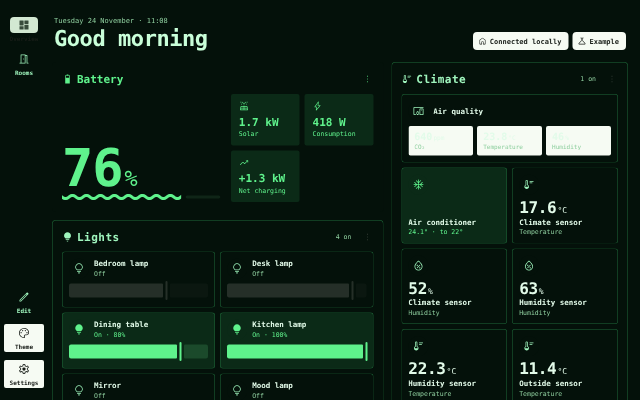
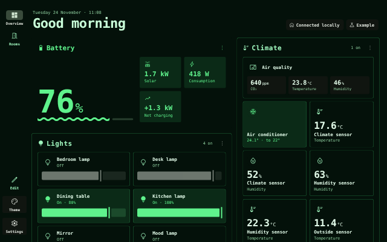
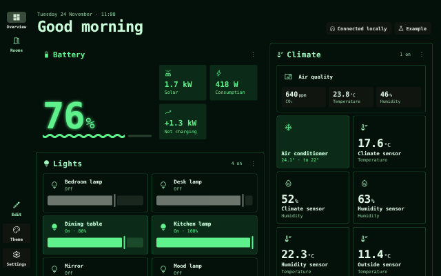

# Terminal

 

**Made by / Gemaakt door** [DIMENTS](https://github.com/DIMENTS) · **Needs / Nodig** Expressive Home 1.3.0 or newer / of nieuwer · **Added / Toegevoegd** 2026-11-25

> Green letters of a typewriter on black. Groene typemachineletters op zwart.

## Share code / Deelcode

Copy the code. In Expressive Home, open Theme → Theme from someone else, and paste it. / Kopieer de code. Open in Expressive Home Thema → Thema van een ander, en plak hem.

```text
EH2.eyJmb3JtYXQiOjIsImlkIjoidC10ZXJtaW5hMDAwMDAwMDAxIiwibmFtZSI6IlRlcm1pbmFsIiwibWFrZXIiOiJESU1FTlRTIiwiYmFzZSI6InJ1c3RpZyIsInNlZWQiOiIjMmY5ZTU3IiwidXNlclNlZWQiOmZhbHNlLCJrbm9icyI6eyJyb3VuZG5lc3MiOiJzcXVhcmUiLCJsZXR0ZXIiOiJzeXN0ZW0ifSwiYXBwIjoiMS4zLjAiLCJ2YWx1ZXMiOnsiYm90aCI6eyJwYWdlLWJnIjoiIzA0MTEwYSIsInBhZ2UtZmciOiIjOWZmNWJkIiwic2VjdGlvbi1iZyI6IiMwNDExMGEiLCJzZWN0aW9uLWZnIjoiIzlmZjViZCIsInNlY3Rpb24tb3V0bGluZSI6IiMxZjZiM2EiLCJzZWN0aW9uLW91dGxpbmUtd2lkdGgiOiIxcHgiLCJ0aWxlLWJnIjoiIzA0MTEwYSIsInRpbGUtZmciOiIjZTJmYmU5IiwidGlsZS1zdGF0ZS1mZyI6IiM4ZmNmOWYiLCJ0aWxlLW91dGxpbmUiOiIjMWY2YjNhIiwidGlsZS1vdXRsaW5lLXdpZHRoIjoiMXB4IiwidGlsZS1vbi1iZyI6IiMwYjJhMTciLCJ0aWxlLW9uLWZnIjoiIzVmZjI4YyIsInRpbGUtaWNvbi1iZyI6IiMwNDExMGEiLCJ0aWxlLWljb24tZmciOiIjOWZmNWJkIiwidGlsZS1pY29uLW9uLWJnIjoiIzBiMmExNyIsInRpbGUtaWNvbi1vbi1mZyI6IiM1ZmYyOGMiLCJ0aWxlLW9uLXNsaWRlci1maWxsIjoiIzVmZjI4YyIsInRpbGUtb24tc2xpZGVyLXRyYWNrIjoiIzFiNGEyYiIsImhlYWRlci1leWVicm93LWZnIjoiIzhmY2Y5ZiIsInJhaWwtaXRlbS1mZyI6IiM5ZmY1YmQiLCJzZWN0aW9uLWNvdW50LWZnIjoiIzhmY2Y5ZiIsInNlY3Rpb24taGVyby1iZyI6IiMwNDExMGEiLCJzZWN0aW9uLWhlcm8tZmciOiIjNWZmMjhjIiwiaGVyby13YXZlLWZnIjoiIzVmZjI4YyIsImhlcm8tY2hhcnQtbGluZSI6IiM1ZmYyOGMiLCJoZXJvLXN0YXQtYmciOiIjMGIyYTE3In19LCJjc3MiOnsidmVyc2lvbiI6MSwidGV4dCI6Ii8qIFRlcm1pbmFsOiBsZXR0ZXJzIG9mIGEgdHlwZXdyaXRlciwgZ3JlZW4gb24gYmxhY2sgKi9cbjo6cGFydChwYWdlKSB7IGZvbnQtZmFtaWx5OiB1aS1tb25vc3BhY2UsIFwiU0ZNb25vLVJlZ3VsYXJcIiwgTWVubG8sIENvbnNvbGFzLCBtb25vc3BhY2U7IH1cbjo6cGFydChzZWN0aW9uLXRpdGxlKSB7IGxldHRlci1zcGFjaW5nOiAxcHg7IH1cbjo6cGFydCh0aWxlLW5hbWUpIHsgY29sb3I6ICNlMmZiZTk7IH1cbjo6cGFydCh0aWxlIG9uKSB7IGJvcmRlci1jb2xvcjogIzVmZjI4YzsgfVxuOjpwYXJ0KGdyZWV0aW5nKSB7IGNvbG9yOiAjYzlmZmQ5OyB9XG4vKiB0aGUgZ2xvdyB3b3JrcyBvbmNlIGl0IGlzIGFsbG93ZWQgKi9cbjo6cGFydChoZXJvLW51bWJlcikgeyB0ZXh0LXNoYWRvdzogMCAwIDhweCAjNWZmMjhjOyB9XG46OnBhcnQodGlsZS1uYW1lIG9uKSB7IHRleHQtc2hhZG93OiAwIDAgNnB4ICMyZjllNTc7IH0ifX0.mklwnp
```

Or download [theme.json](theme.json) and choose it there as a file. / Of download [theme.json](theme.json) en kies het daar als bestand.

## What the check found / Wat de controle vond

- 31 values of its own; 0 left out. / 31 eigen waarden; 0 weggelaten.
- Easy to read everywhere. / Overal goed leesbaar.
- Own CSS: 9 lines. / Eigen CSS: 9 regels.
  - Lines 8, 9 work only once someone allows everything on their device. / Regels 8, 9 werken pas na Alles toestaan op het eigen apparaat.

After Allow everything / Na Alles toestaan:


